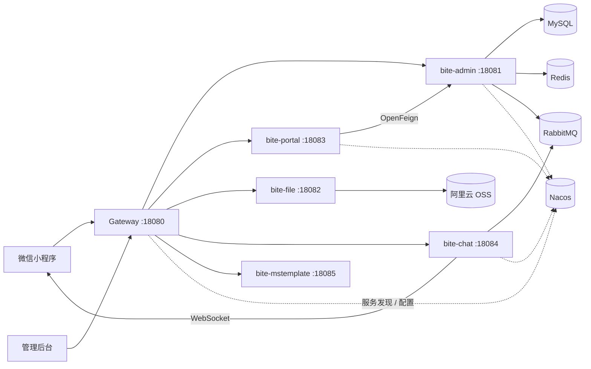

# 云寓租房 · 在线租房平台（Spring Cloud 微服务架构）

> 面向租房场景的 C 端微信小程序 + B 端管理后台。后端按职责拆分为网关、管理、门户、聊天、文件、消息模板 6 个服务，基于 Nacos 做注册与配置中心，由 Gateway 统一路由和鉴权。

> 说明：本项目为个人学习与实战项目，非生产系统。文中出现的密码、AppID、密钥等均为本地开发演示配置，正式使用前请替换为自己的配置。

---

## 一、功能概览

### C 端（微信小程序）

- 首页：定位城市、热门城市、房源推荐
- 城市选择：按拼音/首字母检索城市
- 房源列表：城市、区域、租金、居室、租房类型、排序等多条件筛选与分页
- 房源详情：图片、价格、户型、面积、楼层、设施、标签、地图坐标
- 用户登录：手机号验证码登录 / 微信一键登录，未注册手机号自动注册
- 个人中心：资料编辑、退出登录
- 在线咨询：租客与房源发布者（房东）的实时 IM，支持文本、图片、语音、房源卡片、未读数与历史消息分页

### B 端（管理后台）

- 管理员登录、退出
- 房源管理：列表、详情、新增/编辑、上下架、缓存刷新
- 用户管理
- 系统管理：管理员、角色、菜单、字典等
- 文件上传（阿里云 OSS）

### 通用能力

- 网关统一路由、JWT 鉴权、登录白名单
- 统一响应体、全局异常处理、参数校验
- Redis 缓存、Redisson 分布式锁
- RabbitMQ 消息投递、WebSocket 实时推送
- 统一线程池、日志、工具类

---

## 二、系统架构



### 服务与端口

| 服务 | 端口 | 职责 |
| :--- | :--- | :--- |
| `bite-gateway` | 18080 | 统一入口、路由、JWT 鉴权、白名单 |
| `bite-admin` | 18081 | 管理后台、房源、用户、系统管理 |
| `bite-file` | 18082 | 文件上传、阿里云 OSS |
| `bite-portal` | 18083 | C 端门户：首页、城市、房源、登录 |
| `bite-chat` | 18084 | 会话、消息、WebSocket 推送 |
| `bite-mstemplate` | 18085 | 短信/邮件消息模板 |

---

## 三、技术栈

| 分类 | 技术 / 版本 |
| :--- | :--- |
| 语言 / JDK | Java 17 |
| 构建 | Maven 多模块 |
| 基础框架 | Spring Boot 3.3.3 |
| 微服务 | Spring Cloud 2023.0.3、Spring Cloud Alibaba 2023.0.1.2 |
| 网关 | Spring Cloud Gateway 4.1.5 |
| 服务调用 | OpenFeign + Spring Cloud LoadBalancer |
| 注册 / 配置中心 | Nacos 2.2.2 |
| 持久层 | MyBatis-Plus 3.5.7、MySQL 8.4、HikariCP |
| 缓存 | Redis 7、Redisson 3.29、Caffeine 3.1 |
| 消息队列 | RabbitMQ 3.12 |
| 实时通信 | WebSocket |
| 安全 | JWT（jjwt）、SHA-256、AES-128 |
| 文件存储 | 阿里云 OSS |
| 部署 | Docker / docker-compose |
| 前端 | Vue 3、Vite 6、Element Plus、Pinia；uni-app（Vue 3） |

---

## 四、模块结构

```text
bitehouse
├── bite-gateway                 # 网关：路由、鉴权、白名单
├── bite-admin
│   ├── bite-admin-api           # 对外 Feign 契约、DTO/VO
│   └── bite-admin-service       # 管理端业务实现
├── bite-portal
│   ├── bite-portal-api
│   └── bite-portal-service      # C 端门户业务实现
├── bite-chat
│   ├── bite-chat-api
│   └── bite-chat-service        # 会话、消息、WebSocket、MQ
├── bite-file
│   ├── bite-file-api
│   └── bite-file-service        # OSS 文件服务
├── bite-mstemplate
│   ├── bite-mstemplate-api
│   └── bite-mstemplate-service  # 消息模板服务
├── bite-common                  # 公共能力
│   ├── bite-common-core         # 统一响应/异常、工具、常量、线程池
│   ├── bite-common-domain       # 领域模型、通用 VO/DTO
│   ├── bite-common-redis        # Redis / Redisson 封装
│   ├── bite-common-cache        # Caffeine 本地缓存、两级缓存工具
│   ├── bite-common-rabbitmq     # RabbitMQ 配置与封装
│   ├── bite-common-security     # JWT、登录上下文
│   └── bite-common-message      # 短信验证码等消息能力
└── deploy                       # Docker、SQL、Nacos 配置
```

配套前端（独立目录/仓库）：

| 端 | 技术栈 | 说明 |
| :--- | :--- | :--- |
| 管理后台 | Vue 3 + Vite 6 + Element Plus + Pinia | 房源、用户、系统管理 |
| 用户端小程序 | uni-app + Vue 3 | 微信小程序，9 个页面 |

---

## 五、核心设计

### 1. 网关与统一鉴权

- Gateway 通过 Nacos 服务发现 + `lb://` 负载均衡路由到各服务，使用 `StripPrefix=1` 去掉 `/admin`、`/portal`、`/chat` 等前缀。
- 自定义 `GlobalFilter` 解析 JWT，校验 Redis 中的登录态；通过白名单放行登录、验证码、免登录查询等接口。
- 鉴权失败统一返回 401/403，避免各业务服务重复实现鉴权逻辑。

### 2. 房源检索与缓存

- 基于 MyBatis-Plus 实现城市、区域、租金区间、居室、租房类型、排序等组合条件的分页检索。
- 使用 Redis 维护「城市 → 房源 ID 列表」和「房源详情」缓存，列表页先取 ID 再按需取详情，减少重复查库。
- 缓存刷新、每日房源状态扭转等任务使用 Redisson 分布式锁，避免多实例重复执行。
- 城市、地图等低频变更的基础数据使用 Caffeine + Redis 两级缓存。

### 3. 在线咨询（IM）

- 小程序通过 WebSocket 连接聊天服务，使用心跳消息保活，连接断开时清理本地会话。
- 客户端消息先进入 RabbitMQ Fanout 交换机，由两个消费者分别处理：
  - 实时推送消费者：将消息推送给目标用户；
  - 持久化消费者：将消息写入 `message` 表，并更新会话与未读数。
- 每个服务实例使用独立匿名队列绑定 Fanout，支持多实例部署时的消息广播。
- 消息 ID 使用雪花算法生成，支持历史消息分页、未读数和已读状态。

### 4. 服务拆分与配置管理

- `portal` 通过 OpenFeign 调用 `admin` 获取用户、房源等数据，保持服务边界清晰。
- Nacos 按 `dev / test / prd` 命名空间隔离配置，服务通过 `RUN_ENV`、`NACOS_ADDR` 环境变量接入。

### 5. 安全与文件

- 手机号等敏感字段使用 AES-128 加密存储；管理端密码使用 SHA-256 哈希后比对。
- 文件服务对接阿里云 OSS，统一处理图片上传和访问地址拼接。

---

## 六、快速开始

### 1. 环境要求

- JDK 17
- Maven 3.8+
- Docker / Docker Compose
- Node.js 18+（前端）
- 微信开发者工具（小程序）

### 2. 启动中间件

```bash
cd deploy/dev/app
docker compose -p bitehouse -f docker-compose-mid.yml up -d
```

默认启动 MySQL、Nacos、Redis、RabbitMQ。各中间件默认端口与账号见 `deploy/dev/app/docker-compose-mid.yml`，仅用于本地开发。

### 3. 初始化数据库

在 `deploy/dev/res/sql` 下按顺序导入：

```text
db.sql               # 系统基础表 + 区域、用户、管理员
house.sql            # 房源、房源状态、标签、城市房源关联
houseconfig.sql      # 房源配置数据
chat.sql             # 聊天 session / message 表
demo_house_data.sql  # 可选：500 条演示房源
```

Nacos 配置可从 `deploy/dev/res/sql/nacosdata.sql` 导入，或登录 Nacos 控制台手动创建。需要准备：

- 各服务配置：`bite-gateway`、`bite-admin`、`bite-portal`、`bite-chat`、`bite-file`、`bite-mstemplate`
- 共享配置：`share-common`、`share-redis`、`share-mysql`、`share-rabbitmq`、`share-map`、`share-caffeine`

### 4. 编译后端

```bash
# 在项目根目录执行
mvn -DskipTests package
```

> 如果只编译单个服务，需要带 `-am` 一并构建依赖模块：
>
> ```bash
> mvn -pl bite-portal/bite-portal-service -am -DskipTests package
> ```

### 5. 启动服务

每个服务都通过 `RUN_ENV` 指定环境、`NACOS_ADDR` 指定 Nacos 地址。Windows 下建议加 `-Dfile.encoding=UTF-8`，避免 Nacos 中文配置乱码。

```bash
export RUN_ENV=dev
export NACOS_ADDR=127.0.0.1:8848

java -Dfile.encoding=UTF-8 -Xmx256m -jar bite-gateway/target/bite-gateway.jar
java -Dfile.encoding=UTF-8 -Xmx256m -jar bite-admin/bite-admin-service/target/bite-admin-service.jar
java -Dfile.encoding=UTF-8 -Xmx256m -jar bite-file/bite-file-service/target/bite-file-service.jar
java -Dfile.encoding=UTF-8 -Xmx256m -jar bite-portal/bite-portal-service/target/bite-portal-service.jar
java -Dfile.encoding=UTF-8 -Xmx256m -jar bite-chat/bite-chat-service/target/bite-chat-service.jar
# 可选：消息模板服务
java -Dfile.encoding=UTF-8 -Xmx256m -jar bite-mstemplate/bite-mstemplate-service/target/bite-mstemplate-service.jar
```

启动完成后，所有前端请求统一走网关：`http://127.0.0.1:18080`。

### 6. 启动前端

管理端和用户端小程序是两个独立的前端项目，启动方式见各自目录下的 README。本地开发时可将它们放在本仓库的同级目录，例如：

```text
workspace/
├── bitehouse/                 # 本仓库（后端）
├── biteHouseAdmin/            # 管理端
└── bitehousemp/               # 用户端小程序
```

管理后台：

```bash
cd biteHouseAdmin
npm install
npm run dev
```

用户端小程序：

```bash
cd bitehousemp
npm install
npm run dev:mp-weixin
```

然后用微信开发者工具导入 `dist/dev/mp-weixin`，在「详情 → 本地设置」中勾选“不校验合法域名、web-view（业务域名）、TLS 版本以及 HTTPS 证书”。请使用自己的测试号或小程序 AppID。

### 7. 本地演示账号

- 管理后台：管理员账号见 `db.sql` 初始化数据（默认仅用于本地演示）。
- 小程序：本地未接入真实短信，验证码固定为 `123456`；任意合法手机号登录，未注册会自动创建账号。
- 验证码 5 分钟内有效，同一手机号 1 分钟内不可重复获取。

### 8. 导入演示房源后刷新缓存

```bash
# 先登录管理端获取 token，再调用
curl -X GET http://127.0.0.1:18080/admin/house/refresh \
  -H "Authorization: <admin-token>"
```

---

## 七、常见问题

| 现象 | 原因 / 解决 |
| :--- | :--- |
| 启动时报 `MalformedInputException` 或中文乱码 | Windows JVM 默认编码不是 UTF-8，启动参数加 `-Dfile.encoding=UTF-8` |
| 端口被占用 | 检查 18080~18085、3306、6379、5672、8848 是否已被其他进程占用 |
| `Table 'bitehouse_dev.xxx' doesn't exist` | 业务库未导入表，按「六.3」导入 SQL |
| `Could not resolve placeholder 'caffeine.build.xxx'` | Nacos 中对应服务的配置缺失该键 |
| `Failed to determine a suitable driver class` | Nacos 连接失败，MySQL 配置未拉取，检查 Nacos 地址和 `share-mysql-dev.yaml` |
| 小程序接口全部失败 | 后端未启动、网关 18080 不可达，或开发者工具未勾选“不校验合法域名” |
| 房源列表为空 | 房源状态需为 `UP`，导入演示数据后调用 `/admin/house/refresh` 刷新缓存 |
| 编译单模块提示找不到依赖 | 使用 `mvn -pl <module> -am ...` 一并构建依赖模块 |

---

## 八、后续优化方向

- 消息可靠性：RabbitMQ publisher confirm、消费者手动 ack、失败重试与死信队列
- 消息幂等：为 `message_id` 增加唯一索引，避免重复消费
- 会话幂等：同一对用户重复发起咨询时复用已有会话
- 接口限流：对验证码、消息发送等接口增加 Redis + Lua 限流
- 可观测性：接入 Actuator、Micrometer、Prometheus，日志增加 traceId
- 自动化：补充单元测试、集成测试与 CI 流水线

---

## 九、说明

- 本项目为个人学习/实战项目，重点用于实践微服务拆分、网关鉴权、缓存、消息队列和 WebSocket 等能力。
- 小程序中的部分图标、图片仍引用外部 OSS 地址，正式部署时请替换为自己的资源。
- 仓库中的密码、密钥、AppID 均为本地演示配置，请勿直接用于生产环境。
